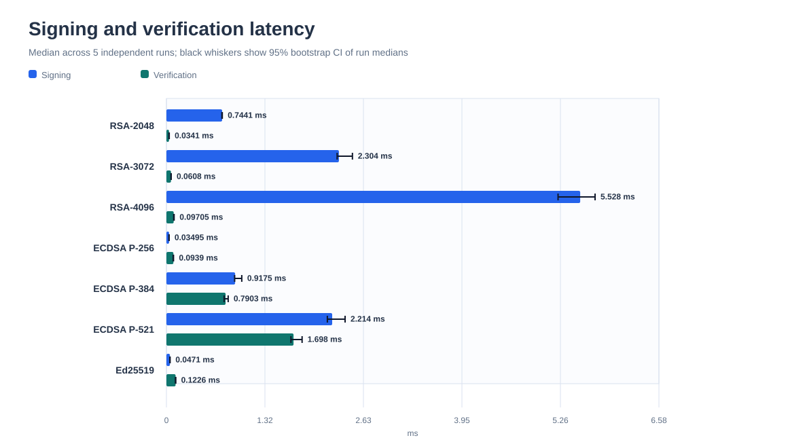
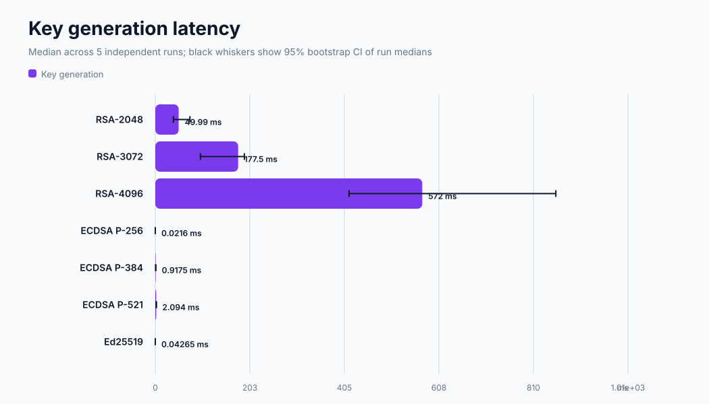

# Frederick Fisler

### Cybersecurity and Cloud Security

M.S. Cybersecurity and Privacy student at the University of Central Florida (Technical Track), with a foundation in applied mathematics, data analytics, and AI applications.

I use this portfolio to document technical projects, experiments, and lessons across cybersecurity, AI security, identity and access management (IAM), and cloud security. It is a growing collection: the digital-signature benchmark is the first published project, and additional projects will be added as they are completed. Each project will include its scope, implementation, evidence, and limitations so the work is easy to review and reproduce.

**Profiles:** [GitHub](https://github.com/frederickfisler) · [LinkedIn](https://www.linkedin.com/in/frederickfisler)

---

## Projects

### Applied cryptography · Published

#### Digital Signature Benchmark

A Python benchmark comparing RSA-PSS, ECDSA, and Ed25519 across key generation, signing, verification, and encoded key and signature sizes. It preserves raw measurements and environment metadata, checks signature acceptance and rejection behavior, and generates charts from the measured JSON runs.

**Measured evidence:** five independent runs, 10 trials per operation per run, 1,024-byte payload, Windows 11, Python 3.14.5, and `cryptography` 50.0.2. The median of run medians showed ECDSA P-256 signing at 0.0350 ms, Ed25519 signing at 0.0471 ms, and RSA-2048 signing at 0.7441 ms. Ed25519 signatures were 64 bytes. Results vary by system and describe this workload, not universal algorithm rankings.

**What it demonstrates**

- 12 signature correctness checks across RSA, ECDSA, and Ed25519.
- Key generation, signing, verification, serialized public-key size, and signature size comparisons.
- Raw latency samples, summary statistics, and environment metadata in five JSON result files.
- Four generated charts, a reproducibility workflow, and continuous integration tests.
- Clear scope limits: this is an educational benchmark, not a security audit or production signing system.

**Technology:** Python · `cryptography` · RSA-PSS · ECDSA · Ed25519 · JSON · GitHub Actions

**[Source code, experiment data, and charts](https://github.com/frederickfisler/frederickfisler.github.io/tree/main/projects/digital-signature-benchmark)** · [Benchmark README](https://github.com/frederickfisler/frederickfisler.github.io/blob/main/projects/digital-signature-benchmark/README.md)

---

## Planned project areas

These are the next areas I plan to build into the portfolio. They are planned work, not completed projects.

### AI security

An applied project exploring how to identify and test security risks in an AI-enabled system, with a documented threat model, controlled evaluation, and mitigations.

### Identity and access management

A practical project on identity lifecycle, least-privilege access, and access review, with evidence showing how permissions are granted and checked.

### Cloud security

A cloud-focused project applying security baselines and configuration checks, with reproducible setup notes and clear treatment of cost and teardown.

---

## Focus areas

- Cybersecurity and cloud security
- Applied cryptography and digital signatures
- AI security and IAM (planned project areas)
- Applied mathematics and data analysis
- Clear experimental methods and evidence-based technical writing

## About this portfolio

Projects are presented as learning and engineering work, with claims tied to observable behavior or recorded measurements. Performance figures are labeled with their environment, and educational demonstrations are not presented as audited or production-ready security products.
