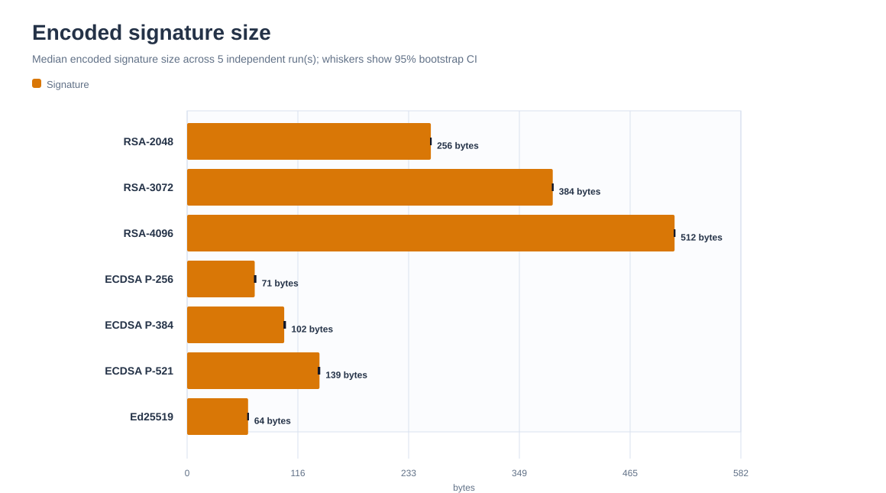
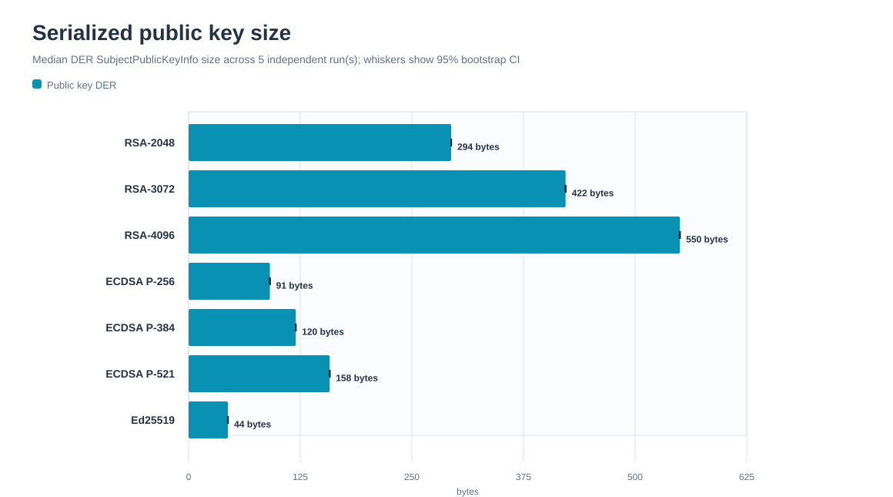

# Digital Signature Benchmark

A Python project for comparing the performance and basic correctness behavior of RSA-PSS, ECDSA, and Ed25519 signatures through the maintained `cryptography` library.

> This is an educational benchmark and correctness demonstration. It does not implement cryptographic primitives, audit their security, or provide a production signing system. Results reflect the recorded Python library, cryptographic backend, operating system, hardware, and workload.

## What it measures

- RSA-PSS with SHA-256 at 2048, 3072, and 4096 bits.
- ECDSA with SHA-256 on NIST P-256, P-384, and P-521 curves.
- Ed25519 signing and verification.
- Key generation, signing, and verification latency, plus serialized public-key and signature sizes.
- Warm-up operations and raw per-operation latency observations.
- Mean, median, standard deviation, range, quartiles, IQR, and 95th percentile.
- Randomized algorithm order per run, with the seed and order saved to JSON.
- Correct signature acceptance and rejection of changed messages, corrupted signatures, and mismatched public keys across all three families.

The built-in default workload is exactly 1,024 bytes. A custom UTF-8 message can be used with `--message`; JSON records its byte length but does not include the message text.

## Results and visualizations

Run several independent experiments on the same computer and use the analyzer to make the result table and four SVG charts. This avoids presenting one short run as a universal ranking.

```powershell
python digital_signature_benchmark.py --iterations 30 --payload-size 1024 --output results/round_01.json
python digital_signature_benchmark.py --iterations 30 --payload-size 1024 --output results/round_02.json
python digital_signature_benchmark.py --iterations 30 --payload-size 1024 --output results/round_03.json
python digital_signature_benchmark.py --iterations 30 --payload-size 1024 --output results/round_04.json
python digital_signature_benchmark.py --iterations 30 --payload-size 1024 --output results/round_05.json
python analyze_results.py results/round_01.json results/round_02.json results/round_03.json results/round_04.json results/round_05.json
```

`analyze_results.py` writes `results/summary.md` and the charts under `assets/`. Timing estimates are the median of per-run medians; the table and chart whiskers show a 95% percentile-bootstrap confidence interval from 10,000 resamples of independent run medians (fixed seed 20261021). Five runs are a small sample, so these intervals are descriptive and should be interpreted cautiously. The charts keep latency operations in separate panels so key generation does not flatten the signing and verification comparisons. Raw JSON remains the source of record.

### Latest measured results

The following figures are the median of per-run medians across five independent runs, with 10 measured trials per operation per run and a 1,024-byte payload. Environment: Windows 11, Python 3.14.5, `cryptography` 50.0.2, Intel processor reported as `Intel64 Family 6 Model 154 Stepping 3, GenuineIntel`. Table confidence intervals use a 10,000-resample percentile bootstrap across run medians.

| Algorithm | Key generation (ms), median [95% CI] | Signing (ms), median [95% CI] | Verification (ms), median [95% CI] | Signature (B) | Public key DER (B) |
|---|---:|---:|---:|---:|---:|
| RSA-2048 | 49.9948 [38.7787, 74.1592] | 0.7441 [0.7418, 0.7461] | 0.0341 [0.0336, 0.0368] | 256 | 294 |
| RSA-3072 | 177.4884 [96.7010, 190.8982] | 2.3044 [2.2810, 2.4849] | 0.0608 [0.0605, 0.0633] | 384 | 422 |
| RSA-4096 | 572.0132 [415.1276, 858.3375] | 5.5283 [5.2318, 5.7266] | 0.0970 [0.0969, 0.1026] | 512 | 550 |
| ECDSA P-256 | 0.0216 [0.0207, 0.0230] | 0.0350 [0.0343, 0.0355] | 0.0939 [0.0900, 0.0941] | 71 | 91 |
| ECDSA P-384 | 0.9175 [0.8809, 0.9707] | 0.9175 [0.9107, 1.0066] | 0.7903 [0.7707, 0.8250] | 102 | 120 |
| ECDSA P-521 | 2.0937 [1.9962, 2.1391] | 2.2144 [2.1503, 2.3871] | 1.6982 [1.6640, 1.8121] | 139 | 158 |
| Ed25519 | 0.0427 [0.0423, 0.0428] | 0.0471 [0.0461, 0.0482] | 0.1226 [0.1216, 0.1234] | 64 | 44 |

Across these runs, ECDSA P-256 had the lowest observed median signing latency; Ed25519 had the smallest fixed-size signature. These are measurements for this workload and environment, not general algorithm rankings. RSA key generation varied substantially between runs.






## Reproduce a run

Requirements: Python 3.10 or newer and the dependency in `requirements.txt`.

```powershell
python -m venv .venv
.\.venv\Scripts\Activate.ps1
python -m pip install -r requirements.txt
python digital_signature_benchmark.py --iterations 30 --payload-size 1024 --output results/run.json
python analyze_results.py results/run.json
```

Run `python digital_signature_benchmark.py --help` for all options. Iterations and payload size must be at least one; `--payload-size` sets the exact size of the built-in payload and is ignored with `--message`. The correctness checks run unless `--skip-tests` is supplied. RSA-4096 key generation can make a run noticeably longer.

Run the standalone test suite with:

```powershell
python -m unittest discover -s tests -v
```

GitHub Actions runs that suite for pushes and pull requests.

## Method and interpretation

Each operation receives five warm-up calls before the requested number of timed trials. Timing uses Python's `time.perf_counter()` and reports milliseconds. Key generation, signing, and verification are timed separately. Signing and verification reuse one generated key pair for that algorithm and the same payload. RSA uses PSS with maximum salt length and SHA-256; ECDSA uses SHA-256; Ed25519 uses its native API.

An operation's raw latencies are preserved in JSON. Percentiles use linear interpolation between ordered samples. Standard deviation is the sample standard deviation. The analyzer bootstraps the median of run medians using 10,000 resamples with seed 20261021 and reports the 2.5th and 97.5th percentile endpoints. Algorithm order is shuffled for each run, and the seed/order are recorded. Independent runs should be made under comparable conditions; CPU load, thermal and power state, and background processes may affect measurements. The Python wrapper and cryptographic backend are part of what is measured, so these are not isolated algorithm timings.

Interpret results as observations for a documented setup. Do not infer that the fastest configuration is the most secure or the best choice for every application. Encoded size is not a measure of security strength, and ECDSA's DER signature length can vary between generated signatures.

## Security limitations

- Digital signatures provide integrity and authenticity properties; they do not encrypt or hide the signed message.
- The project does not implement key storage, identity validation, certificates, revocation, protocol design, or side-channel analysis.
- The checks demonstrate expected API behavior for a small set of failure cases. They are not a cryptographic security audit or exhaustive verification.
- Use established libraries and follow current protocol guidance for real systems.

## Project files

```text
digital_signature_benchmark.py  Benchmark CLI
analyze_results.py              SVG charts and Markdown result table
tests/                          Automated correctness and CLI tests
results/                        Selected JSON experiments and summary
assets/                         Generated charts
.github/workflows/tests.yml     Continuous integration
requirements.txt                Runtime dependency
```

## Portfolio summary

Built a Python benchmark for RSA-PSS, ECDSA, and Ed25519 that measures key generation, signing, and verification while retaining raw timing data and environment metadata. Added signature correctness checks, percentile analysis, JSON reporting, automated tests, and reproducible SVG charts. Results are explicitly scoped to the recorded environment and are not presented as a security audit or universal algorithm ranking.

## Author

Frederick Fisler
